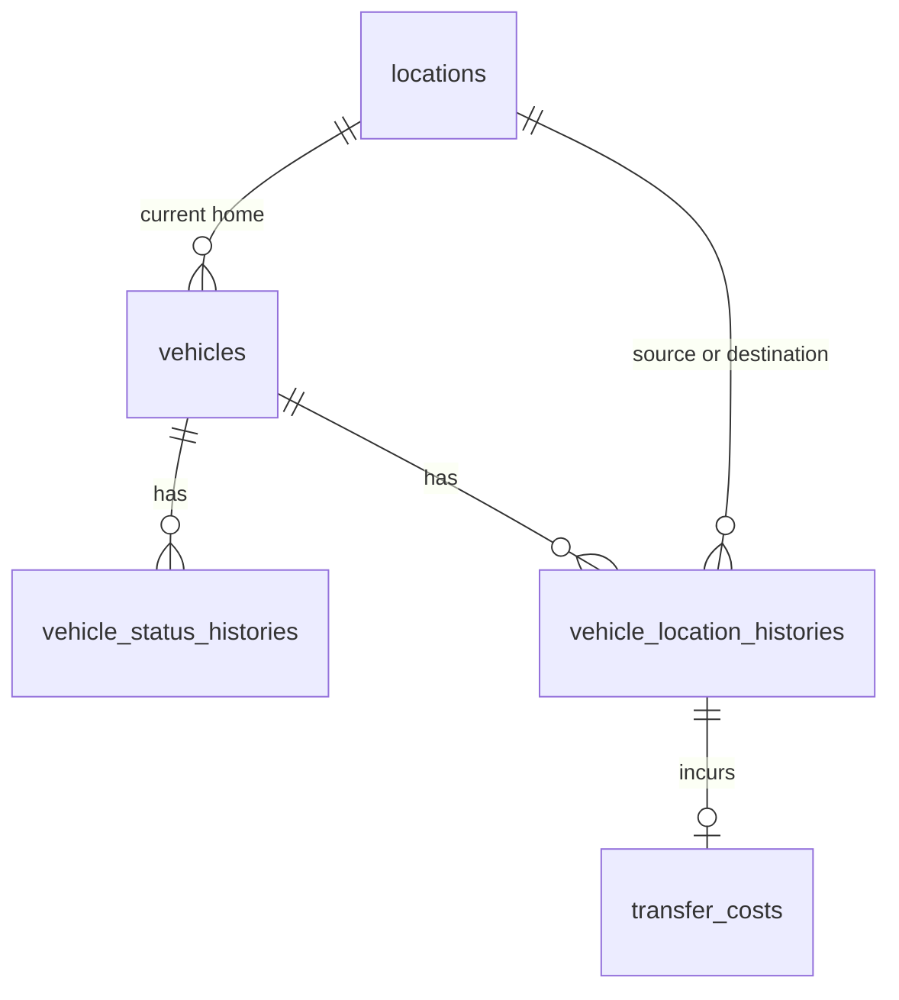

# Database Design - Car Management - Location & Inventory Management

## Table of Contents

- [Entity Relationship Diagram](#entity-relationship-diagram)
- [locations](#locations)
- [vehicles](#vehicles)
- [vehicle_status_histories](#vehicle_status_histories)
- [vehicle_location_histories](#vehicle_location_histories)
- [transfer_costs](#transfer_costs)
- [Common Record and Deletion Rules](#common-record-and-deletion-rules)

## Entity Relationship Diagram

## locations

| Field name | Data type | Index | Database constraints | Description |
|---|---|---|---|---|
| location_id | UUID | Primary key | Not null | Stable identifier for a fleet location. |
| display_name | TEXT | Non-unique index | Not null | Staff-facing name. Additional address fields require product confirmation. |
| created_at | TIMESTAMP WITH TIME ZONE | — | Not null | Creation timestamp. |
| updated_at | TIMESTAMP WITH TIME ZONE | — | Not null | Last update timestamp. |
| deleted_at | TIMESTAMP WITH TIME ZONE | — | Nullable | Soft-deletion timestamp. |
| created_by | TEXT | — | Not null | Authenticated actor that created the record. |
| updated_by | TEXT | — | Not null | Authenticated actor that last updated the record. |
| deleted | BOOLEAN | — | Not null; default `false` | Soft-deletion flag. |

## vehicles

| Field name | Data type | Index | Database constraints | Description |
|---|---|---|---|---|
| vehicle_id | UUID | Primary key | Not null | Stable identifier for the vehicle record. |
| vin | TEXT | Conditional case-insensitive unique index | Nullable until field requiredness is finalized; unique among non-deleted records when present | Vehicle identification number. |
| license_plate | TEXT | Index; conditional uniqueness scope pending registration-jurisdiction decision | Nullable until field requiredness is finalized | Vehicle registration plate. Enforce case-insensitive uniqueness within the confirmed jurisdiction scope when defined. |
| purchase_date | DATE | — | Requiredness per approved field-requirements matrix | Date the company purchased the vehicle. |
| purchase_cost | DECIMAL(15,2) | — | Non-negative when present; requiredness per approved field-requirements matrix | Vehicle purchase cost. Currency policy is not specified in the PRD. |
| insurance_details | TEXT | — | Requiredness per approved field-requirements matrix | Insurance details as supplied by the business; structured subfields require confirmation. |
| insurance_expires_on | DATE | — | Requiredness per approved field-requirements matrix | Insurance expiration date. |
| odometer | DECIMAL | — | Non-negative when present; requiredness per approved field-requirements matrix | Odometer reading stored in kilometers to align with the PRD's maintenance-distance unit. |
| brand | TEXT | — | Requiredness per approved field-requirements matrix | Vehicle brand. |
| model | TEXT | — | Requiredness per approved field-requirements matrix | Vehicle model. |
| manufacturing_year | INTEGER | — | Positive when present; requiredness per approved field-requirements matrix | Vehicle manufacturing year. |
| size | TEXT | — | One of `small`, `medium` when present; requiredness per approved field-requirements matrix | Vehicle size category. |
| vehicle_class | TEXT | — | One of `economy`, `luxury` when present; requiredness per approved field-requirements matrix | Rental class (the single canonical field for the PRD's “class”). |
| seat_count | INTEGER | — | Positive when present; requiredness per approved field-requirements matrix | Number of seats. |
| fuel_type | TEXT | — | One of `gas`, `electric`, `hybrid` when present; requiredness per approved field-requirements matrix | Vehicle fuel type. |
| ownership | TEXT | — | Not null; fixed to `company` by the service | Only company-owned vehicles are in scope. |
| status | TEXT | Index | Not null; default `incoming`; one of `incoming`, `active`, `maintenance`, `decommissioning`, `sold` | Current lifecycle status. This is the only current-status field; do not duplicate it as `lifecycle_status`. |
| home_location_id | UUID | Index; foreign key to `locations.location_id` | Not null | Vehicle's current home location. Must reference a non-deleted location. |
| created_at | TIMESTAMP WITH TIME ZONE | — | Not null | Creation timestamp. |
| updated_at | TIMESTAMP WITH TIME ZONE | — | Not null | Last update timestamp. |
| deleted_at | TIMESTAMP WITH TIME ZONE | — | Nullable | Soft-deletion timestamp. |
| created_by | TEXT | — | Not null | Authenticated actor that created the record. |
| updated_by | TEXT | — | Not null | Authenticated actor that last updated the record. |
| deleted | BOOLEAN | — | Not null; default `false` | Soft-deletion flag. |

## vehicle_status_histories

| Field name | Data type | Index | Database constraints | Description |
|---|---|---|---|---|
| vehicle_status_history_id | UUID | Primary key | Not null | Stable identifier for a vehicle status change. |
| vehicle_id | UUID | Index; foreign key to `vehicles.vehicle_id` | Not null | Vehicle whose status changed. |
| previous_status | TEXT | — | Nullable for initial status; otherwise one of `incoming`, `active`, `maintenance`, `decommissioning`, `sold` | Status before the change. |
| new_status | TEXT | — | Not null; one of `incoming`, `active`, `maintenance`, `decommissioning`, `sold` | Status applied to the vehicle. |
| changed_at | TIMESTAMP WITH TIME ZONE | Index | Not null | Time the status change was recorded. |
| created_at | TIMESTAMP WITH TIME ZONE | — | Not null | Creation timestamp. |
| updated_at | TIMESTAMP WITH TIME ZONE | — | Not null | Last update timestamp. |
| deleted_at | TIMESTAMP WITH TIME ZONE | — | Nullable | Soft-deletion timestamp. |
| created_by | TEXT | — | Not null | Authenticated actor that initiated the status change. |
| updated_by | TEXT | — | Not null | Authenticated actor that last updated the history record. |
| deleted | BOOLEAN | — | Not null; default `false` | Soft-deletion flag. |

## vehicle_location_histories

| Field name | Data type | Index | Database constraints | Description |
|---|---|---|---|---|
| vehicle_location_history_id | UUID | Primary key | Not null | Stable identifier for a vehicle's location assignment or transfer. |
| vehicle_id | UUID | Index; foreign key to `vehicles.vehicle_id` | Not null | Vehicle associated with this location event. |
| from_location_id | UUID | Foreign key to `locations.location_id` | Nullable for initial assignment | Prior home location; null for initial onboarding. |
| to_location_id | UUID | Index; foreign key to `locations.location_id` | Not null | New home location. |
| effective_at | TIMESTAMP WITH TIME ZONE | Index | Not null | Time the assignment or transfer takes effect. |
| created_at | TIMESTAMP WITH TIME ZONE | — | Not null | Time the history record was created. |
| updated_at | TIMESTAMP WITH TIME ZONE | — | Not null | Time the history record was last updated. |
| deleted_at | TIMESTAMP WITH TIME ZONE | — | Nullable | Soft-deletion timestamp. |
| created_by | TEXT | — | Not null | Authenticated actor that recorded the assignment or transfer. |
| updated_by | TEXT | — | Not null | Authenticated actor that last updated the record. |
| deleted | BOOLEAN | — | Not null; default `false` | Soft-deletion flag. |

## transfer_costs

| Field name | Data type | Index | Database constraints | Description |
|---|---|---|---|---|
| transfer_cost_id | UUID | Primary key | Not null | Stable identifier for an incurred transfer cost. |
| vehicle_location_history_id | UUID | Unique index; foreign key to `vehicle_location_histories.vehicle_location_history_id` | Not null | Transfer associated with this aggregate cost. |
| amount | DECIMAL(15,2) | — | Not null; non-negative | Cost amount recorded for the transfer. |
| currency_code | TEXT | — | Not null | Currency code supplied by the caller under the configured business currency policy. |
| allocation_target | TEXT | — | Not null; fixed to `company_pool` | Required company-pool cost allocation. |
| created_at | TIMESTAMP WITH TIME ZONE | — | Not null | Creation timestamp. |
| updated_at | TIMESTAMP WITH TIME ZONE | — | Not null | Last update timestamp. |
| deleted_at | TIMESTAMP WITH TIME ZONE | — | Nullable | Soft-deletion timestamp. |
| created_by | TEXT | — | Not null | Authenticated actor that recorded the cost. |
| updated_by | TEXT | — | Not null | Authenticated actor that last updated the record. |
| deleted | BOOLEAN | — | Not null; default `false` | Soft-deletion flag. |

## Common Record and Deletion Rules

- Every table includes `created_at`, `updated_at`, and nullable `deleted_at` as timestamps with time zone; `created_by` and `updated_by` as text; and `deleted` as a boolean defaulting to `false`.
- Keep `deleted` and `deleted_at` consistent. Do not physically remove inventory, locations, transfers, or costs through ordinary application operations.
- A location referenced by a current vehicle or retained location history cannot be soft-deleted. A vehicle cannot reference a deleted location as its current home.
- Vehicle creation must create its initial location-history record in the same transaction. Each transfer must create one history record and update `vehicles.home_location_id` in the same transaction.
- Vehicle creation must set `vehicles.status` to `incoming` and create an initial status-history record in the same transaction. Later status changes must update `vehicles.status` and append one status-history record atomically.
- All vehicle attributes are captured, but whether individual attributes are mandatory is controlled by the approved field-requirements matrix, as required by the PRD. Non-null system-owned fields and home location remain mandatory.
- PR #14 uses the shared vehicle master as its authoritative source and stores allocation/unavailability separately; do not add duplicate availability, allocation, or maintenance-block fields to `vehicles`.
- Retain historical `from_location_id` and `to_location_id` references even when a location is no longer used as a current home location.
- Use decimal precision 15 and scale 2 for monetary values. Currency conversion and accounting-ledger posting are outside this design.
