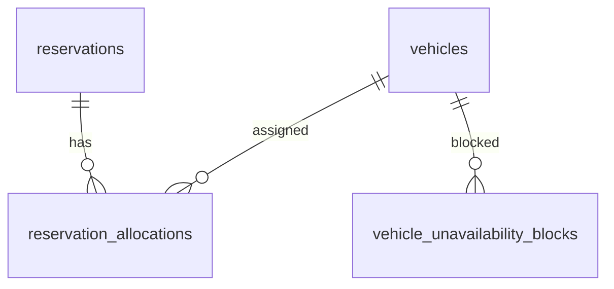

# Database Design - Reservation Allocation

## Table of Contents

- [Entity Relationship Diagram](#entity-relationship-diagram)
- [Tables](#tables)
  - [reservations](#reservations)
  - [reservation_allocations](#reservation_allocations)
  - [vehicle_unavailability_blocks](#vehicle_unavailability_blocks)

## Entity Relationship Diagram

`vehicles` is the authoritative vehicle master maintained by the fleet-management capability and is referenced here; this document does not define its fields.

## Tables

Each table includes the audit and soft-deletion fields required by the TRD database-design standard. `deleted` defaults to `false`; when a record is soft-deleted, set `deleted_at` and retain the record for audit and historical allocation checks.

### reservations

| Field name | Data type | Index | Database constraints | Description |
|---|---|---|---|---|
| id | UUID | Primary key | Not null | Reservation identifier. |
| customer_id | UUID | Yes | Not null; references the customer identity maintained by the reservation capability | Customer reference; customer details are not duplicated here. |
| requested_start_at | TIMESTAMP WITH TIME ZONE | Yes, with `requested_end_at` | Not null | Start instant of the requested rental period. |
| requested_end_at | TIMESTAMP WITH TIME ZONE | Yes, with `requested_start_at` | Not null; later than `requested_start_at` | End instant of the requested rental period. |
| created_at | TIMESTAMP WITH TIME ZONE | Yes | Not null | Original reservation receipt time; source for first-come, first-served ordering and tie-breaking input. |
| updated_at | TIMESTAMP WITH TIME ZONE | No | Not null | Last update time. |
| deleted_at | TIMESTAMP WITH TIME ZONE | No | Nullable | Soft-deletion time; null unless deleted. |
| created_by | TEXT | No | Not null | Actor that created the reservation record. |
| updated_by | TEXT | No | Not null | Actor that last updated the reservation record. |
| deleted | BOOL | Yes | Not null; default `false` | Soft-deletion flag. |

### reservation_allocations

| Field name | Data type | Index | Database constraints | Description |
|---|---|---|---|---|
| id | UUID | Primary key | Not null | Allocation record identifier. |
| reservation_id | UUID | Yes | Not null; references `reservations.id` | Reservation receiving the vehicle. |
| vehicle_id | UUID | Yes, with `allocation_status` | Not null; references the authoritative vehicle identifier | Vehicle assigned to the reservation. |
| allocation_status | TEXT | Yes, with `vehicle_id` | Not null; allowed values: `active`, `released` | Current or historical allocation state. |
| allocated_at | TIMESTAMP WITH TIME ZONE | Yes | Not null | Time the allocation was committed. |
| released_at | TIMESTAMP WITH TIME ZONE | No | Nullable; required when status is `released` | Time the allocation ceased to apply. |
| created_at | TIMESTAMP WITH TIME ZONE | No | Not null | Record creation time. |
| updated_at | TIMESTAMP WITH TIME ZONE | No | Not null | Last update time. |
| deleted_at | TIMESTAMP WITH TIME ZONE | No | Nullable | Soft-deletion time; null unless deleted. |
| created_by | TEXT | No | Not null | Actor that created the allocation record. |
| updated_by | TEXT | No | Not null | Actor that last updated the allocation record. |
| deleted | BOOL | Yes | Not null; default `false` | Soft-deletion flag. |

Maintain at most one active allocation per reservation. For any vehicle, active allocations must not overlap the associated reservation periods. Enforce both rules atomically during allocation; the overlap rule is a logical invariant independent of database-specific range-constraint support. Keep released records for allocation history.

### vehicle_unavailability_blocks

| Field name | Data type | Index | Database constraints | Description |
|---|---|---|---|---|
| id | UUID | Primary key | Not null | Unavailability-block identifier. |
| vehicle_id | UUID | Yes, with `block_status`, `starts_at`, and `ends_at` | Not null; references the authoritative vehicle identifier | Vehicle made unavailable for a period. |
| block_type | TEXT | Yes | Not null; allowed values: `maintenance`, `turnaround` | Source category of the unavailability. |
| block_status | TEXT | Yes, with `vehicle_id` | Not null; allowed values: `active`, `cancelled` | Whether the block currently affects availability. |
| starts_at | TIMESTAMP WITH TIME ZONE | Yes, with `vehicle_id` and `ends_at` | Not null; earlier than `ends_at` | Start instant of the block. |
| ends_at | TIMESTAMP WITH TIME ZONE | Yes, with `vehicle_id` and `starts_at` | Not null; later than `starts_at` | End instant of the block. |
| source_reference | TEXT | No | Nullable | Reference to the originating maintenance schedule or return event. |
| created_at | TIMESTAMP WITH TIME ZONE | No | Not null | Record creation time. |
| updated_at | TIMESTAMP WITH TIME ZONE | No | Not null | Last update time. |
| deleted_at | TIMESTAMP WITH TIME ZONE | No | Nullable | Soft-deletion time; null unless deleted. |
| created_by | TEXT | No | Not null | Actor that created the block. |
| updated_by | TEXT | No | Not null | Actor that last updated the block. |
| deleted | BOOL | Yes | Not null; default `false` | Soft-deletion flag. |

An active block overlapping any part of the requested rental period makes the vehicle unavailable. Represent a scheduled maintenance day using the applicable operating location's local-day boundaries, converted to instants. Represent turnaround from the recorded return through one local calendar day after the return; this accommodates daylight-saving changes without changing the business duration.
