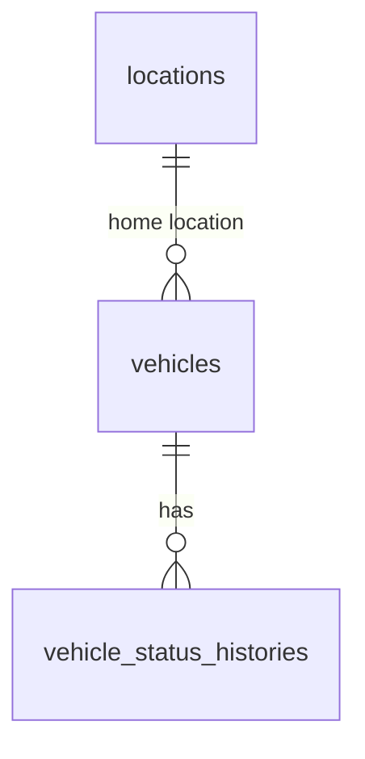

# Database Design - Vehicle Onboarding

## Table of Contents

- [vehicles](#vehicles)
- [vehicle_status_histories](#vehicle_status_histories)

## Entity Relationship Diagram

`locations` is the shared location master referenced by `home_location_id`; its design is maintained by the location and inventory capability. The vehicle record is the authoritative shared vehicle master; other capabilities reference it instead of defining duplicate vehicle fields.

## vehicles

| Field name | Data type | Index | Database constraints | Description |
|---|---|---|---|---|
| `vehicle_id` | UUID | Primary key | Not null | Server-assigned vehicle identifier. |
| `vin` | TEXT | Unique index on non-deleted, non-empty values | Requiredness per approved field-requirements matrix | Vehicle identification number. Unique among non-deleted records when provided. |
| `license_plate` | TEXT | Index; uniqueness scope pending jurisdiction confirmation | Requiredness per approved field-requirements matrix | Vehicle registration plate. Do not enforce global uniqueness until registration jurisdiction is defined. |
| `purchase_date` | DATE | — | Requiredness per approved field-requirements matrix | Date the company purchased the vehicle. |
| `purchase_cost` | DECIMAL(15,2) | — | Non-negative when provided; requiredness per approved field-requirements matrix | Company purchase cost. |
| `insurance_details` | TEXT | — | Requiredness per approved field-requirements matrix | Insurance details captured for the vehicle. |
| `insurance_expires_on` | DATE | — | Requiredness per approved field-requirements matrix | Insurance expiration date. |
| `odometer_km` | BIGINT | — | Non-negative when provided; requiredness per approved field-requirements matrix | Current recorded odometer reading in kilometers, consistent with the PRD's maintenance-distance unit. |
| `brand` | TEXT | — | Requiredness per approved field-requirements matrix | Vehicle brand. |
| `model` | TEXT | — | Requiredness per approved field-requirements matrix | Vehicle model. |
| `manufacturing_year` | SMALLINT | — | Positive when provided; requiredness per approved field-requirements matrix | Vehicle manufacturing year. |
| `size` | TEXT | — | One of `small`, `medium`; requiredness per approved field-requirements matrix | Vehicle size. |
| `vehicle_class` | TEXT | — | One of `economy`, `luxury`; requiredness per approved field-requirements matrix | Rental vehicle class. |
| `seat_count` | INTEGER | — | Positive when provided; requiredness per approved field-requirements matrix | Number of seats. |
| `fuel_type` | TEXT | — | One of `gas`, `electric`, `hybrid`; requiredness per approved field-requirements matrix | Vehicle fuel type. |
| `ownership` | TEXT | — | Not null; fixed to `company` | Only company-owned vehicles are in scope; set by the service. |
| `lifecycle_status` | TEXT | Index | Not null; one of `incoming`, `active`, `maintenance`, `decommissioning`, `sold`; defaults to `incoming` | Current lifecycle status. This is the single current-status field; the same allowed values apply to status history. |
| `home_location_id` | UUID | Index; foreign key to `locations.location_id` | Not null; references a non-deleted location | Vehicle's current home location. |
| `created_at` | TIMESTAMP WITH TIME ZONE | — | Not null | Record creation time. |
| `updated_at` | TIMESTAMP WITH TIME ZONE | — | Not null | Most recent record update time. |
| `deleted_at` | TIMESTAMP WITH TIME ZONE | — | Nullable | Time the record was soft-deleted, if applicable. |
| `created_by` | TEXT | — | Not null | Authenticated actor that created the record. |
| `updated_by` | TEXT | — | Not null | Authenticated actor that last updated the record. |
| `deleted` | BOOLEAN | — | Not null; default `false` | Soft-deletion marker. |

## vehicle_status_histories

| Field name | Data type | Index | Database constraints | Description |
|---|---|---|---|---|
| `vehicle_status_history_id` | UUID | Primary key | Not null | Server-assigned status history identifier. |
| `vehicle_id` | UUID | Foreign key; index | References `vehicles.vehicle_id`; not null | Vehicle whose lifecycle status changed. |
| `previous_status` | TEXT | — | Nullable for initial status; otherwise one of `incoming`, `active`, `maintenance`, `decommissioning`, `sold` | Lifecycle status before the change. |
| `new_status` | TEXT | — | Not null; one of `incoming`, `active`, `maintenance`, `decommissioning`, `sold` | Lifecycle status applied to the vehicle. |
| `changed_at` | TIMESTAMP WITH TIME ZONE | — | Not null | Time the status change was recorded. |
| `created_at` | TIMESTAMP WITH TIME ZONE | — | Not null | History record creation time. |
| `updated_at` | TIMESTAMP WITH TIME ZONE | — | Not null | Most recent history record update time. |
| `deleted_at` | TIMESTAMP WITH TIME ZONE | — | Nullable | Time the record was soft-deleted, if applicable. |
| `created_by` | TEXT | — | Not null | Authenticated actor that initiated the status change. |
| `updated_by` | TEXT | — | Not null | Authenticated actor that last updated the history record. |
| `deleted` | BOOLEAN | — | Not null; default `false` | Soft-deletion marker. |

Create an initial history record when a vehicle is onboarded, with `previous_status` unset and `new_status` set to `incoming`. Status changes and their history records are persisted together so `vehicles.lifecycle_status` and its audit trail remain consistent. The approved field-requirements matrix must resolve vehicle-attribute requiredness before implementation; the PRD requires every vehicle to reference a home location.
