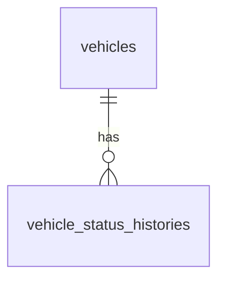

# Database Design - Vehicle Onboarding

## Table of Contents

- [vehicles](#vehicles)
- [vehicle_status_histories](#vehicle_status_histories)

## Entity Relationship Diagram

## vehicles

| Field name | Data type | Index | Database constraints | Description |
|---|---|---|---|---|
| `vehicle_id` | UUID | Primary key | Not null | Server-assigned vehicle identifier. |
| `vin` | TEXT | Unique | Requiredness per approved field-requirements matrix | Vehicle identification number. Unique among non-deleted records when provided. |
| `license_plate` | TEXT | Unique | Requiredness per approved field-requirements matrix | Vehicle registration plate. Unique among non-deleted records when provided. |
| `purchase_date` | DATE | — | Requiredness per approved field-requirements matrix | Date the company purchased the vehicle. |
| `purchase_cost` | DECIMAL(15,2) | — | Non-negative when provided; requiredness per approved field-requirements matrix | Company purchase cost. |
| `insurance_details` | TEXT | — | Requiredness per approved field-requirements matrix | Insurance details captured for the vehicle. |
| `insurance_expires_on` | DATE | — | Requiredness per approved field-requirements matrix | Insurance expiration date. |
| `odometer` | DECIMAL | — | Non-negative when provided; requiredness per approved field-requirements matrix | Current recorded odometer reading; unit follows the product’s configured measurement system. |
| `brand` | TEXT | — | Requiredness per approved field-requirements matrix | Vehicle brand. |
| `model` | TEXT | — | Requiredness per approved field-requirements matrix | Vehicle model. |
| `manufacturing_year` | INTEGER | — | Positive when provided; requiredness per approved field-requirements matrix | Vehicle manufacturing year. |
| `size` | TEXT | — | One of `small`, `medium` when provided; requiredness per approved field-requirements matrix | Vehicle size. |
| `class` | TEXT | — | One of `economy`, `luxury` when provided; requiredness per approved field-requirements matrix | Rental vehicle class. |
| `seat_count` | INTEGER | — | Positive when provided; requiredness per approved field-requirements matrix | Number of seats. |
| `fuel_type` | TEXT | — | One of `gas`, `electric`, `hybrid` when provided; requiredness per approved field-requirements matrix | Vehicle fuel type. |
| `ownership` | TEXT | — | Must be `company` | Only company-owned vehicles are in scope; set by the service. |
| `status` | TEXT | — | One of `incoming`, `active`, `maintenance`, `decommissioning`, `sold` | Current lifecycle status; defaults to `incoming` at onboarding. |
| `created_at` | TIMESTAMP WITH TIME ZONE | — | Not null | Record creation time. |
| `updated_at` | TIMESTAMP WITH TIME ZONE | — | Not null | Most recent record update time. |
| `deleted_at` | TIMESTAMP WITH TIME ZONE | — | Nullable | Time the record was soft-deleted, if applicable. |
| `created_by` | TEXT | — | Not null | Authenticated actor that created the record. |
| `updated_by` | TEXT | — | Not null | Authenticated actor that last updated the record. |
| `deleted` | BOOLEAN | — | Not null; default `false` | Soft-deletion marker. |

## vehicle_status_histories

| Field name | Data type | Index | Database constraints | Description |
|---|---|---|---|---|
| `vehicle_status_history_id` | UUID | Primary key | Not null | Server-assigned status history identifier. |
| `vehicle_id` | UUID | Foreign key; index | References `vehicles.vehicle_id`; not null | Vehicle whose lifecycle status changed. |
| `previous_status` | TEXT | — | Nullable for initial status; otherwise a supported status | Status before the change. |
| `new_status` | TEXT | — | One of `incoming`, `active`, `maintenance`, `decommissioning`, `sold`; not null | Status applied to the vehicle. |
| `changed_at` | TIMESTAMP WITH TIME ZONE | — | Not null | Time the status change was recorded. |
| `created_at` | TIMESTAMP WITH TIME ZONE | — | Not null | History record creation time. |
| `updated_at` | TIMESTAMP WITH TIME ZONE | — | Not null | Most recent history record update time. |
| `deleted_at` | TIMESTAMP WITH TIME ZONE | — | Nullable | Time the record was soft-deleted, if applicable. |
| `created_by` | TEXT | — | Not null | Authenticated actor that initiated the status change. |
| `updated_by` | TEXT | — | Not null | Authenticated actor that last updated the history record. |
| `deleted` | BOOLEAN | — | Not null; default `false` | Soft-deletion marker. |

Create an initial history record when a vehicle is onboarded, with `previous_status` unset and `new_status` set to `incoming`. Status changes and their history records are persisted together so the current status and its audit trail remain consistent.
