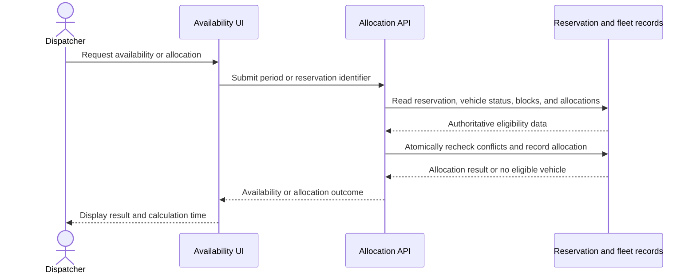

# TRD - Reservation Allocation

## Document Information

- Feature Name: Reservation Allocation
- Author: @copilot
- Date:
- Version:

## Table of Contents

- [Background](#background)
- [In Scope](#in-scope)
- [Constraints](#constraints)
- [Technical Requirements](#technical-requirements)
- [Security Requirement](#security-requirement)
- [Non-Functional Requirements](#non-functional-requirements)
- [AI usage disclaimer](#ai-usage-disclaimer)

## Background

This document defines technical requirements for **Availability and reservation allocation**, Functional Requirement 3 in the [Car Management PRD](../prd/prd-car-management.md#3-availability-and-reservation-allocation). It translates the PRD requirement to show current and planned availability, automatically allocate eligible vehicles first-come, first-served, and prevent double bookings.

## In Scope

- Calculate and present vehicle availability for a requested rental period within the PRD's current and planned availability horizons.
- Allocate one eligible vehicle to a reservation automatically, using reservation receipt order and without model or class preference.
- Exclude vehicles that are not active, are otherwise marked unavailable for rent (including for a critical fault), have an active maintenance block, are in their one-day post-return turnaround, or meet the insurance-expiry exclusion.
- Prevent simultaneous allocation requests from assigning the same vehicle for overlapping periods.
- Record allocation outcomes and provide the dispatcher with availability and allocation results.

## Constraints

- Allocation depends on authoritative reservation and vehicle records. Vehicle lifecycle status, insurance expiration, maintenance schedules, and return events are owned by fleet-management functions and must be available to the allocation capability.
- This design assumes one vehicle per reservation. Multi-vehicle reservations are not specified by the PRD.
- The PRD does not define the exact boundary or overlap of “real time through two hours” and “H+1 through H+30,” or define the unit represented by H. Confirm these meanings before configuring or publishing the supported availability horizon.
- The insurance exclusion is stated as “within one week of insurance expiration” without defining the reference point. This design proposes that insurance remain valid through the rental end plus seven days; the business must confirm this interpretation before launch.
- Reservation cancellation, extension approval, substitutions, customer pricing, vehicle prioritization, and reservation creation are outside this TRD.
- Database and API designs are technology-agnostic. No specific database, programming language, identity provider, or integration provider is selected.

## Technical Requirements

### Database Design

Use the related [Reservation Allocation Database Design](database-design-reservation-allocation.md) for conceptual entities, fields, relationships, and constraints. The allocation capability references the existing vehicle record as its authoritative source; it does not redefine the vehicle master.

### Frontend

- Provide a period selector and an availability view covering only the business-approved current and planned horizons.
- Distinguish current availability from planned availability and show the time at which availability was last calculated.
- Display an allocated vehicle and allocation outcome after a successful allocation. If no eligible vehicle exists, explain that no vehicle is available without implying that the reservation was accepted or rejected by another workflow.
- Do not offer a vehicle as available if its eligibility data is unavailable or stale beyond the freshness policy established by the vehicle-record owner.
- Do not sort or recommend candidates by vehicle model or class. If candidate ordering is needed for display, use a stable, neutral ordering.

### Backend

#### REST API

All timestamps are RFC 3339 instants with an explicit UTC offset. Rental periods are represented as a start and end instant, with the start preceding the end. Treat periods as start-inclusive and end-exclusive for overlap checks; business owners must confirm this boundary convention alongside the availability-horizon clarification.

**Allocate a reservation**

- Method: `POST`
- URL: `/reservations/{reservationId}/allocation`
- Path parameter: `reservationId` — identifier of an existing reservation.
- Query parameters: none.
- Request body: none.
- Response body on success: allocation identifier, reservation identifier, vehicle identifier, allocation status, and allocation timestamp.
- Responses:
  - `200` when the reservation already has an active allocation and the request is an idempotent retry; return the active allocation.
  - `201` when a vehicle is newly allocated.
  - `400` for malformed identifiers or request metadata.
  - `401` or `403` for unauthenticated or unauthorized callers.
  - `404` when the reservation does not exist or is not visible to the caller.
  - `409` when no eligible vehicle is available, the reservation period conflicts with the configured horizon, or a concurrent state change prevents allocation. Return a stable machine-readable reason category.
  - `422` when the reservation period is invalid or required eligibility data is missing or invalid.

**Read availability**

- Method: `GET`
- URL: `/availability`
- Path parameters: none.
- Query parameters:
  - `startAt` — required rental-period start instant.
  - `endAt` — required rental-period end instant.
  - `locationId` — optional filter when the authoritative vehicle records support a location filter; it must not affect first-come, first-served ordering.
- Request body: none.
- Response body: calculation timestamp, applied horizon identifier or bounds, and a list of vehicle identifiers with availability state. Include an exclusion-reason category for unavailable vehicles only when the caller is authorized to see operational details.
- Responses: `200` for a valid query; `400` for malformed parameters; `401` or `403` for authentication/authorization failures; `422` for an invalid period or a period outside the confirmed supported horizon.

#### Validation and consistency

- Require `startAt < endAt`; reject missing offsets, malformed timestamps, and periods outside the business-approved horizon.
- Validate the reservation and its period against the authoritative reservation record. Do not accept client-supplied vehicle eligibility, status, insurance, maintenance, or return facts as authoritative.
- Consider a vehicle eligible only when it is active and not otherwise marked unavailable for rent; has no overlapping active maintenance block; has completed its one-day post-return turnaround; has no active allocation to an overlapping reservation; and satisfies the confirmed insurance-expiry rule.
- Apply the proposed insurance rule conservatively: exclude a vehicle if its insurance expiration is at or before the requested period's end plus seven days. The confirmed business rule must replace this proposal if the interpretation differs.
- Calculate turnaround as one local calendar day after the recorded return, using the applicable operating location's time zone, rather than assuming a fixed 24-hour duration. Convert resulting boundaries to instants for overlap comparison.
- Treat reservation periods and unavailability periods as overlapping when each starts before the other's end. An end exactly equal to another period's start does not overlap.
- Use the reservation's original receipt timestamp as the first-come, first-served order. Resolve equal timestamps consistently using reservation identifier as a tie-breaker. Do not apply a model, class, size, or price preference.

#### Allocation sequence

1. Authenticate and authorize the caller; load the reservation and authoritative vehicle eligibility data.
2. Validate the reservation period and the configured availability horizon.
3. Enter a transaction or equivalent concurrency-safe operation. Queue or otherwise serialize competing allocation requests with overlapping periods by the reservation's original receipt time, with the stable tie-breaker; do not let API arrival or processing-thread order change the first-come, first-served sequence.
4. Recheck current allocations and unavailability blocks inside the concurrency-safe operation. Select an eligible vehicle using a stable neutral vehicle identifier order; do not rank by model or class.
5. If no candidate remains, return the no-availability outcome without creating an allocation.
6. Create the active reservation-to-vehicle allocation atomically, guarded by a final overlap check. If another operation has claimed the vehicle, retry candidate selection or return a conflict; never commit an overlapping active allocation.
7. Record the actor and timestamps, commit, and return the result. A repeated request for the same reservation returns its current active allocation instead of creating another.

## Security Requirement

- Require authentication for both endpoints. Enforce the repository's deployment identity and access-control standards; do not introduce a new authentication mechanism in this TRD.
- Authorize availability reads and allocation writes separately. Limit allocation writes to the operational staff authorized to dispatch reservations; define the exact role mapping before launch because the PRD does not specify roles.
- Enforce authorization on the server for every request and reservation identifier; do not rely on UI controls to prevent unauthorized access.
- Return only the identifiers and operational details needed by the dispatcher. Do not expose customer identity data or unrelated vehicle details in availability responses.
- Use parameterized data access, validate path and query parameters, and avoid returning internal errors, credentials, or raw data-source details to callers.
- Record allocation, release, and administrative changes with actor and timestamp audit fields. Protect audit records from unauthorized modification.
- Use transport encryption and the platform's approved storage protections for reservation and fleet data. Do not include sensitive data in logs; retain request correlation identifiers and non-sensitive reason categories for troubleshooting.
- Ensure that retries and concurrent requests cannot bypass eligibility checks or create overlapping active allocations.

## Non-Functional Requirements

## AI usage disclaimer

*This document was generated with the assistance of artificial intelligence and should be reviewed by a human for accuracy and completeness.*
